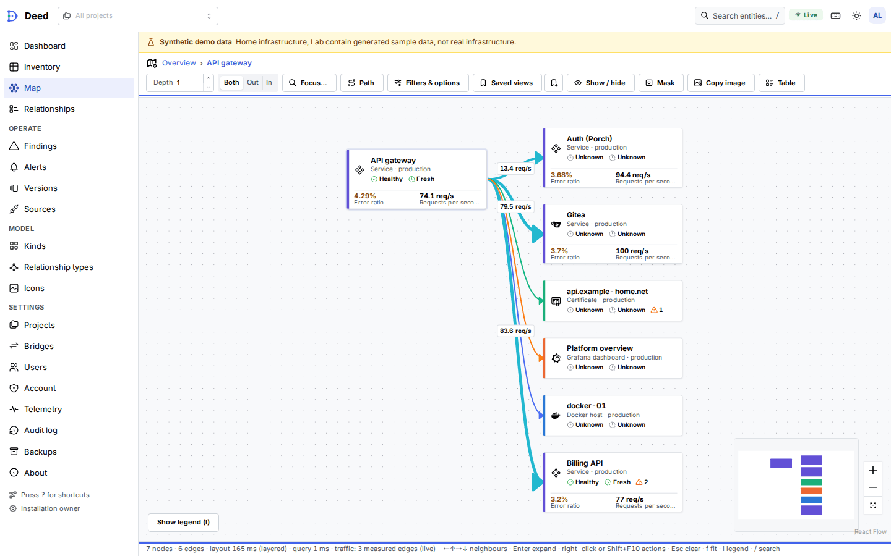
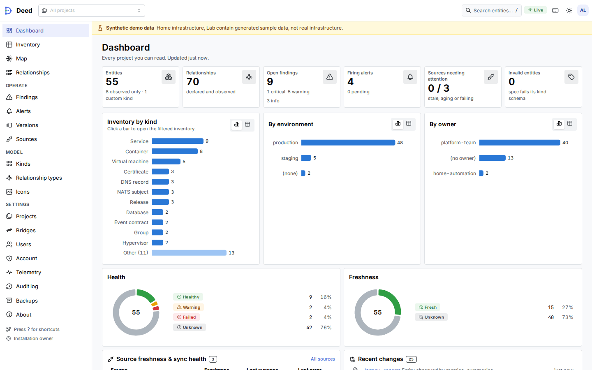
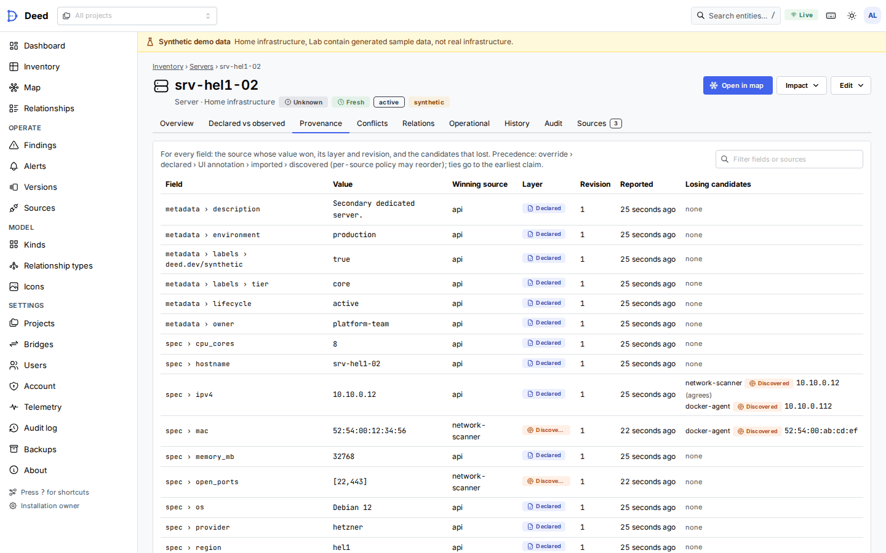
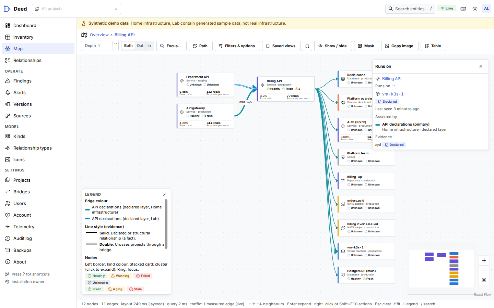
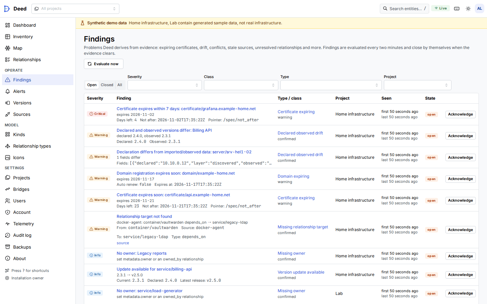
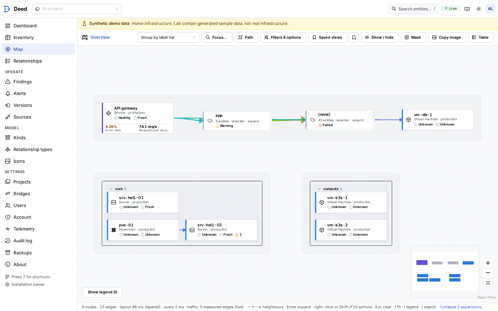
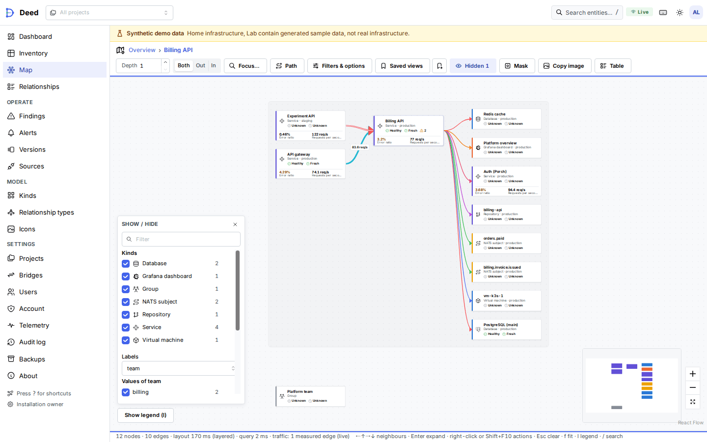

<p align="center">
  <picture>
    <source media="(prefers-color-scheme: dark)" srcset="docs/assets/deed-wordmark-dark.svg">
    
  </picture>
</p>

# Deed

**Declarative infrastructure catalog and live relationship map, powered by Go, Terraform, and React Flow.**

Deed is a source-aware graph of infrastructure, software, identities and operational relationships. It answers what
you have, where it runs, who owns it, how it is connected, what depends on it, which services publish or consume
which Pulse/NATS events, and — for every value — where it came from and how fresh it is.

> **Status:** pre-1.0 and under active development; not externally security reviewed. Releases (binaries, SBOMs,
> checksums and a container image) are on [GitHub Releases](https://github.com/aurimasniekis/go-deed/releases); the
> `/api/v1` compatibility promise is in [docs/VERSIONING.md](docs/VERSIONING.md). The capability matrix is
> [docs/ACCEPTANCE.md](docs/ACCEPTANCE.md); what has actually been run end to end (and what is still pending against
> real services) is in [docs/VALIDATION.md](docs/VALIDATION.md). Documentation site: https://aurimasniekis.github.io/go-deed/

## Screenshots
<picture>
  <source media="(prefers-color-scheme: dark)" srcset="docs/assets/screenshots/map-metrics-dark.png">
  
</picture>

<table>
<tr>
<td width="50%">

<picture>
  <source media="(prefers-color-scheme: dark)" srcset="docs/assets/screenshots/dashboard-dark.png">
  
</picture>

<p align="center"><b>Dashboard</b></p>
</td>
<td width="50%">

<picture>
  <source media="(prefers-color-scheme: dark)" srcset="docs/assets/screenshots/entity-provenance-dark.png">
  
</picture>

<p align="center"><b>Why does this value exist?</b> Field-level provenance</p>
</td>
</tr>
<tr>
<td width="50%">

<picture>
  <source media="(prefers-color-scheme: dark)" srcset="docs/assets/screenshots/map-source-dark.png">
  
</picture>

<p align="center"><b>Map coloured by source</b>, with the edge inspector</p>
</td>
<td width="50%">

<picture>
  <source media="(prefers-color-scheme: dark)" srcset="docs/assets/screenshots/findings-dark.png">
  
</picture>

<p align="center"><b>Findings</b> derived from evidence</p>
</td>
</tr>
<tr>
<td width="50%">

<picture>
  <source media="(prefers-color-scheme: dark)" srcset="docs/assets/screenshots/map-grouped-dark.png">
  
</picture>

<p align="center"><b>Group by</b> kind, project, location, team or any label</p>
</td>
<td width="50%">

<picture>
  <source media="(prefers-color-scheme: dark)" srcset="docs/assets/screenshots/map-show-hide-dark.png">
  
</picture>

<p align="center"><b>Show / hide</b> kinds, label values and relationship types</p>
</td>
</tr>
</table>

All screenshots show clearly labelled synthetic data, seeded and captured in both themes by the browser test suite
(`web/e2e/a11y.spec.ts`, `web/e2e/showcase.spec.ts`). More in the [web UI guide](docs/UI.md).

## What it does
- **Catalog** of entities (built-in kinds plus custom kinds with versioned JSON Schemas) in projects, connected by
  typed relationships with evidence (declared, structural, observed, inferred).
- **Layered facts:** every source writes its own facet; a deterministic field-level merge with provenance answers
  "why does this value exist?", and disagreements surface as conflicts instead of silent overwrites. Project
  **label rules** add labels (such as `group=github`) to entities other sources own, below every source.
- **Sources:** the [Terraform provider](https://github.com/aurimasniekis/terraform-provider-deed) (`aurimasniekis/deed`),
  Terraform state import (push, S3, HTTP backend; allowlisted attributes only), GitHub, HallPass and Porch connectors,
  Pulse (admin API, read-only `evt.>` tail, ingest consumer), and any program with a source token
  (`pkg/deedclient`, `deed-agent` for Docker).
- **Map:** server-side neighbourhoods, impact and path queries with node caps and fan clustering; an overview grouped
  by kind, project, environment, owner, location, region, team or any label, with groups expanding in place;
  telemetry values inside node cards and traffic overlays only where a measurement exists; colour by relationship
  type, health, freshness, evidence or source; show / hide by kind, label value or relationship type; right-click
  quick actions; mask mode for screenshots; copy the whole map as an image; saved views and live updates over SSE.
- **Operations:** findings and alerts (expiring certificates, drift, stale sources, end-of-life versions,
  unreachable integrations) delivered as Pulse events; named telemetry bindings for Prometheus/Mimir, Loki, NATS
  monitoring, OpenSearch and Grafana; Prometheus metrics, Grafana dashboard and alert rules.
- **Security and durability:** Argon2id + TOTP + recovery codes, OIDC SSO (Porch first), project roles, scoped tokens
  and service accounts for automation, CSRF, SSRF-guarded outbound calls, hash-chained audit log, age-encrypted
  backups with signed manifests and tested restore.

## Quick start
From a [release](https://github.com/aurimasniekis/go-deed/releases) (Linux and macOS binaries with the web UI
embedded) or the container image `ghcr.io/aurimasniekis/go-deed`, follow [docs/DEPLOYMENT.md](docs/DEPLOYMENT.md);
behind Cloudflare: [docs/CLOUDFLARE.md](docs/CLOUDFLARE.md).

From source (Go 1.27, Node 24 with pnpm for the UI):
```sh
make web build                                          # the UI first: `make build` embeds whatever web/ built
bin/deed migrate -config deploy/dev/deed.yaml
bin/deed admin bootstrap -config deploy/dev/deed.yaml   # single-use setup link for the first owner
bin/deed demo seed -config deploy/dev/deed.yaml         # optional: a clearly labelled synthetic demo project
bin/deed serve -config deploy/dev/deed.yaml             # http://127.0.0.1:8787
```
`deploy/compose.dev.yaml` starts NATS, MinIO, Prometheus, Loki and Grafana; `scripts/e2e.sh` runs the full acceptance
scenario against them.

## Documentation
| Topic | Document |
|---|---|
| Decisions | [Discovery](docs/DISCOVERY.md), [ADRs](docs/adr/README.md), [Threat model](docs/THREAT_MODEL.md) |
| Operating | [Deployment](docs/DEPLOYMENT.md), [Cloudflare](docs/CLOUDFLARE.md), [SSO](docs/SSO.md), [Service accounts](docs/SERVICE_ACCOUNTS.md), [Backups](docs/BACKUP.md), [Operations](docs/OPERATIONS.md) |
| Integrating | [Ingest API](docs/INGEST_API.md), [Terraform import](docs/TERRAFORM_IMPORT.md), [Connectors](docs/CONNECTORS.md), [Pulse](docs/PULSE.md), [Telemetry](docs/TELEMETRY.md), [Agent and SDK](docs/AGENT.md) |
| Using | [Web UI guide](docs/UI.md) |
| Modelling | [Custom kinds](docs/CUSTOM_KINDS.md), [Label rules](docs/LABEL_RULES.md), [Findings and alerts](docs/FINDINGS.md), [Icons](docs/ICONS.md) |
| Quality | [Testing](docs/TESTING.md), [Validation](docs/VALIDATION.md), [Performance](docs/PERFORMANCE.md) |
| Releases | [Versioning](docs/VERSIONING.md), [Compatibility](docs/COMPATIBILITY.md), [Releasing](docs/RELEASING.md), [Changelog](CHANGELOG.md) |

Security reports: see [SECURITY.md](SECURITY.md). Contributions: [CONTRIBUTING.md](CONTRIBUTING.md).

## License
Apache License 2.0. Copyright 2026 Aurimas Niekis. See [LICENSE](LICENSE) and [NOTICE](NOTICE).
