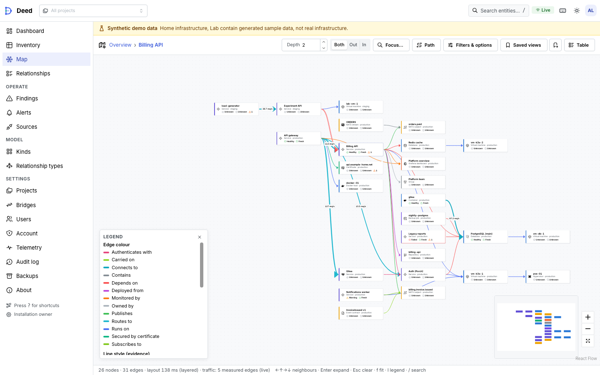
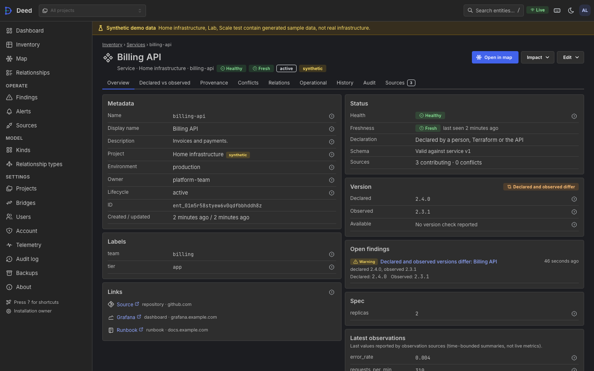
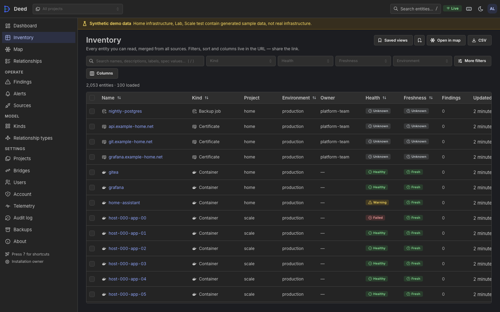

# Deed web UI

The web UI is a single-page React application in `web/`, built into `internal/webui/dist` and embedded in the `deed`
binary (ADR-011). It talks only to the public `/api/v1` API and `/auth/*` routes; everything it can do, the API and
CLI can do too.



| Dashboard (light)                                                 | Entity overview (dark)                                                      |
| ----------------------------------------------------------------- | --------------------------------------------------------------------------- |
|  |  |



Screenshots are produced by the accessibility suite (`web/e2e/screenshots/`, every view in both themes) against
synthetic seed data.

## Building and developing

| Command                       | What it does                                                                                                                     |
| ----------------------------- | -------------------------------------------------------------------------------------------------------------------------------- |
| `make web`                    | `pnpm install --frozen-lockfile`, then `make web-build`                                                                          |
| `make web-build`              | `tsc`, production build into `internal/webui/dist`, `scripts/check-dist.mjs`                                                     |
| `make web-dev`                | Vite dev server proxying `/api` and `/auth` to a running deed at `DEED_API` (default `http://127.0.0.1:8787`)                    |
| `make web-lint`               | ESLint (strict type-checked, react-hooks, jsx-a11y strict, `--max-warnings=0`) and Prettier check                                |
| `make web-test` / `web-check` | `tsc --noEmit`, lint, Vitest unit tests (`web/src/**/*.test.ts`); part of `make check`                                           |
| `make web-gen`                | Regenerates the typed API client; CI fails when it is stale                                                                      |
| `make web-e2e`                | Playwright + axe against a freshly seeded server (run `make web-build` first; builds `bin/deed` unless `DEED_E2E_BINARY` is set) |

- TypeScript 7 (the native compiler, installed as the `typescript-7` alias) type-checks the app. The `typescript`
  package itself is TypeScript 6, because typescript-eslint and openapi-typescript need the JavaScript compiler API
  that TypeScript 7 does not ship. No pnpm hooks are involved, so `package.json` + `pnpm-lock.yaml` alone install
  reproducibly (the container build relies on that).
- `make web-gen` (`pnpm gen:api`) regenerates `src/api/schema.gen.ts` from `api/openapi.json`; the client
  (`openapi-fetch`) is fully typed from it, so API drift fails `tsc`.
- The dev proxy rewrites `Origin` to the backend's origin, because the server's CSRF check compares `Origin` with its
  own URL.
- TanStack Query/Router devtools load only under `import.meta.env.DEV`. `scripts/check-dist.mjs` fails the build when
  `dist` contains devtools markers, inline `<script>` bodies, `eval`/`new Function`, non-image `data:` URIs in CSS,
  or is missing `README.txt`.

### Security constraints

- **CSP**: no inline scripts or styles from our code, no external fonts or CDNs, no `eval`. Fonts
  (`@fontsource-variable/inter`, `…/jetbrains-mono`) and icons (Tabler, `simple-icons`) are bundled. Mantine's
  injected `<style>` tags carry the per-request nonce read from `<meta name="deed-csp-nonce">`.
- **Session**: cookie session only. Tokens (API tokens, setup/recovery codes) are shown once and never written to
  `localStorage`/`sessionStorage`; `localStorage` holds UI preferences only (theme, map options, column layouts,
  dismissed hints).
- **CSRF**: every mutating request sends `X-Deed-CSRF` with the token from `GET /auth/me`; the token is replaced
  whenever the session rotates.
- **Re-authentication**: a 401/403 `reauth_required` or `mfa_required` problem opens the re-authentication modal
  (password + TOTP → `POST /auth/reauth`) or follows the problem's SSO `action`, then retries the original request
  once with the new CSRF token; concurrent requests share one prompt.
- ESLint bans `dangerouslySetInnerHTML`, `innerHTML`/`outerHTML` assignment, `insertAdjacentHTML`-style parsers,
  `document.write` and devtools imports outside dev-only modules.

## Information architecture

```
Dashboard                 /                      health, counts, recent changes, open findings/alerts, sources
Inventory                 /inventory             virtualized table, URL-encoded filters, saved views, bulk, CSV
  Entity                  /entities/:id          overview · compare (declared vs observed) · provenance · conflicts ·
                                                 relations · operational (telemetry) · history · audit · sources
Map                       /map                   overview / neighbourhood / path / impact; options drawer; legend
Relationships             /relations             relation table with evidence
Findings                  /findings              rule results, acknowledge/suppress
Alerts                    /alerts                alerts · rules · silences
Versions                  /versions              newest release / end-of-life status per versioned entity, re-check
Sources                   /sources               list, schema-driven create/edit, test, preview, sync, runs, tokens
Kinds                     /kinds                 kind list, schema editor; /relationship-types
Icons                     /settings/icons        custom SVG icons (custom:<name>), monochrome ones tinted per theme
Settings                  /settings              projects (members, tokens), bridges, users, account (MFA,
                                                 sessions), telemetry (integrations, bindings), backups, audit, about
```

Every page's state that a user might share — filters, sort, selected tab, map focus/mode/depth/layout/options — lives
in typed URL search params (TanStack Router validators and codecs in `src/lib/urlState.ts`), so links and the back button reproduce a
view exactly. Server state is TanStack Query; live updates come from SSE (`/api/v1/stream/*`, `src/api/live.ts`) and
invalidate only the affected query keys. Telemetry SSE patches edge/entity data in place and never triggers a
relayout.

Role-gated actions are hidden for roles that cannot perform them, and the server remains the authority: a 403 shows
the server's reason inline rather than failing silently.

## Design system

- Mantine 8 with a single theme (`src/theme/theme.ts`): neutral grays, one indigo accent (`#4263eb`, the logo
  colour), 4 px radii, Inter for text and JetBrains Mono for identifiers, IDs and code. Light and dark schemes are
  first-class; dark uses its own shade (`primaryShade.dark = 7`) and surface tokens rather than an inverted palette.
- Status vocabulary is fixed and always rendered as icon + label (`StatusBadge`): healthy, degraded, down, unknown,
  stale; severity info/warning/critical. Status colours are never reused for categories.
- Kinds have an icon (Tabler or brand mark from `simple-icons`) and a group accent; relationship types have a colour
  from a fixed categorical order (ADR-011c), overridable per saved view.
- Empty, loading and error states are shared components (`src/components/States.tsx`) and always say what to do next.

## Map interaction model

Modes: **overview** (projects/kinds aggregated into group nodes), **neighbourhood** (focus entity + depth),
**path** (between two entities) and **impact** (downstream of the focus). The server enforces depth and node caps
(`max_nodes` ≤ 2,000) and aggregates into cluster nodes beyond its threshold, so the client never renders more than
the ADR-011 budget.

- Click selects and opens the inspector; double-click or `Enter` expands a node or cluster in place; the arrow keys
  move the selection to the nearest neighbour in that direction, so the map is fully keyboard-operable.
- Layouts: ELK layered (direction configurable), force (d3-force) and radial around the focus, all computed in Web
  Workers. Layered layouts wrap very tall layers (a hub with hundreds of neighbours) into several columns so large
  neighbourhoods stay compact. Layout runs only when topology changes; dragged nodes are pinned and saved with the
  view.
- **Edge encoding** (ADR-011c): colour by relationship type (or health/freshness); solid = declared, dashed = inferred
  (hover shows the evidence), dotted = stale, thick double = bridge, faded = unknown. Width is log-scaled measured
  rate, only for fresh measurements.
- **Traffic overlay**: rates come from `/graph/edge-rates`. Only `measured` edges animate (flow dots, speed ∝ rate,
  labelled "sampled, N-min window"); `inferred` rates are labelled with their note and never animate; `unavailable`
  edges are never animated. All animation stops under `prefers-reduced-motion` or the user toggle.
- The legend is generated from the styles actually on screen. Options (filters, grouping, layout, colour mode,
  routing, labels, animation, node density) persist per saved view.

## Accessibility

- Target: WCAG 2.2 AA. Every route is scanned with axe (`@axe-core/playwright`, tags `wcag2a`, `wcag2aa`, `wcag21a`,
  `wcag21aa`, `wcag22aa`) in both light and dark schemes by `web/e2e/a11y.spec.ts`; serious or critical violations
  fail the run.
- Landmarks and a skip link on every page; one `h1` per page; visible `:focus-visible` rings; target sizes ≥ 24 px; the
  map has a keyboard model (above) and every node/edge is also reachable through the inspector and the relations
  table.
- Information is never colour-only: statuses carry icons and labels, edge evidence classes differ in stroke pattern,
  and the legend names every encoding.
- Motion honours `prefers-reduced-motion`.
- ESLint `jsx-a11y` (strict) runs in CI.

## Keyboard shortcuts

Press `?` anywhere to see them in the app.

| Keys                                  | Action                                                    |
| ------------------------------------- | --------------------------------------------------------- |
| `/`, `⌘/Ctrl K`                       | Search entities and pages                                 |
| `?`                                   | Shortcut help                                             |
| `g d` / `g i` / `g m` / `g r`         | Dashboard / inventory / map / relationships               |
| `g f` / `g a` / `g s` / `g k` / `g p` | Findings / alerts / sources / kinds / projects            |
| Map: arrows                           | Move selection to the nearest neighbour in that direction |
| Map: `Enter`                          | Expand the selected node or cluster                       |
| Map: `Esc`                            | Clear selection, close panels                             |
| Map: `f` / `i` / `l`                  | Fit view / impact of selection / toggle legend            |
| Map: `+` / `−`                        | Zoom                                                      |
| Inventory: `Space`                    | Toggle the focused row's checkbox                         |

## Performance budgets and measurements

Budgets (ADR-011): ≤ 2,000 nodes and 4,000 edges rendered at once; time to first neighbourhood < 500 ms p95 for
typical neighbourhoods; 60 fps pan/zoom with ≤ 500 nodes.

`web/e2e/perf.spec.ts` measures, against the production build served by `deed`: fetch → layout → first rendered frame
(`performance.mark('deed-map-rendered')`) and `requestAnimationFrame` intervals while panning. Run it with
`DEED_E2E_LARGE=2000 make web-e2e` (or `pnpm exec playwright test perf.spec.ts`); results land in
`web/e2e/.state/perf.json`.

Measured 2026-10-25 on an Apple M1 Max (10 cores, 64 GiB, macOS), Chromium headless via Playwright at 1440×900,
production build served by `deed` from the same machine:

| Scenario                                                  | Nodes / edges | Layout  | Fetch → first frame        | Pan frame time p50 / p95 (fps) |
| --------------------------------------------------------- | ------------- | ------- | -------------------------- | ------------------------------ |
| Seeded neighbourhood (`api-gateway`, depth 2–3, ×5)       | 26 / 31       | layered | 197–244 ms (layout 127 ms) | 16.7 / 16.7 ms (60)            |
| Large neighbourhood (`core-net`, depth 2, `--large 2000`) | 2,000 / 1,999 | layered | 1,719 ms (layout 1,019 ms) | 16.7 / 83 ms (31)              |
| same                                                      | 2,000 / 1,999 | force   | 1,974 ms (layout 1,244 ms) | 67 / 100 ms (16)               |
| same                                                      | 2,000 / 1,999 | radial  | 1,052 ms (layout 5 ms)     | 16.7 / 16.8 ms (59)            |

The server answers the 2,000-node neighbourhood query in ~45 ms; the remaining time is layout (in a worker) and the
first React Flow render. Typical neighbourhoods are well inside the 500 ms budget. At the 2,000-node cap the map stays
usable but misses both budgets for layered and force layouts: the first frame takes 1–2 s and panning a fully visible
2,000-node drawing drops to 16–31 fps (viewport culling only helps once zoomed in). Known follow-ups: a
level-of-detail node renderer at low zoom (dots instead of cards), and caching layouts per saved view so a revisit
skips the worker.

## Testing

- **Unit** (Vitest): API session/CSRF/reauth handling, SSE reconnect and invalidation mapping, URL codecs, schema
  forms, edge styling, map model and layout helpers, provenance rendering.
- **End-to-end** (Playwright, Chromium): `e2e/global-setup.ts` starts a fresh `deed` with a temporary data dir and
  mock upstreams (Prometheus, GitHub API), seeds projects, kinds, sources, entities, relations, telemetry and
  findings (the owner account is enrolled in TOTP during setup), then runs: auth (password + TOTP sign-in with
  return-to, setup-link and SSO error pages), core flows (dashboard → finding → inventory → entity → focused map →
  path; impact; bulk annotations; relations table), map (filters, grouping, inspector, keyboard, provenance, overview
  expansion, traffic overlay on measured edges only), admin (GitHub source create/test/preview against the mock,
  push-token reveal-once, custom kind with schema dry run, audit hash-chain verification, saved views, version
  re-check, custom icon upload, findings re-evaluation), an axe scan of 27 views in both schemes plus the login page
  (screenshots to `web/e2e/screenshots/`), and the perf budgets.
