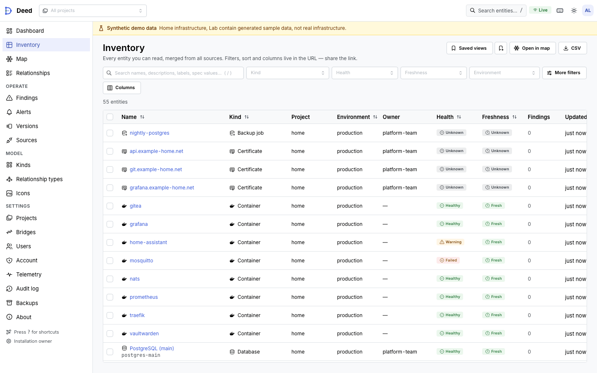
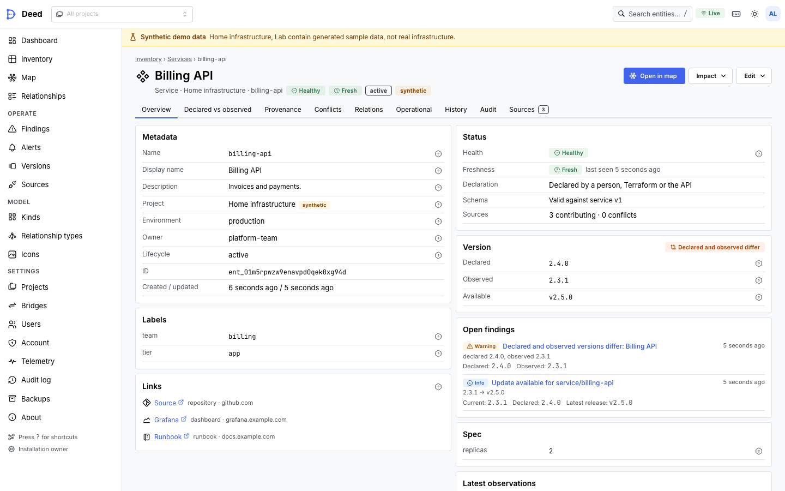

# Deed web UI

The web UI is a single-page React application in `web/`, built into `internal/webui/dist` and embedded in the `deed`
binary (ADR-011). It talks only to the public `/api/v1` API and `/auth/*` routes; everything it can do, the API and
CLI can do too.

**Map, focused on a service**

<picture>
  <source media="(prefers-color-scheme: dark)" srcset="assets/screenshots/map-focus-dark.png">
  
</picture>

**Map coloured by source, edge inspector open**

<picture>
  <source media="(prefers-color-scheme: dark)" srcset="assets/screenshots/map-source-dark.png">
  
</picture>

**Dashboard**

<picture>
  <source media="(prefers-color-scheme: dark)" srcset="assets/screenshots/dashboard-dark.png">
  
</picture>

**Inventory**

<picture>
  <source media="(prefers-color-scheme: dark)" srcset="assets/screenshots/inventory-dark.png">
  
</picture>

**Entity overview**

<picture>
  <source media="(prefers-color-scheme: dark)" srcset="assets/screenshots/entity-overview-dark.png">
  
</picture>

**Provenance — "why does this value exist?"**

<picture>
  <source media="(prefers-color-scheme: dark)" srcset="assets/screenshots/entity-provenance-dark.png">
  
</picture>

**Findings**

<picture>
  <source media="(prefers-color-scheme: dark)" srcset="assets/screenshots/findings-dark.png">
  
</picture>

Screenshots are produced by the accessibility suite (`web/e2e/screenshots/`, every view in both themes) against
synthetic seed data.

## Building and developing

| Command                       | What it does                                                                                                                     |
| ----------------------------- | -------------------------------------------------------------------------------------------------------------------------------- |
| `make web`                    | `pnpm install --frozen-lockfile`, then `make web-build`                                                                          |
| `make web-build`              | `tsc`, production build into `internal/webui/dist`, `scripts/check-dist.mjs`                                                     |
| `make web-dev`                | Vite dev server proxying `/api` and `/auth` to a running deed at `DEED_API` (default `http://127.0.0.1:8787`)                    |
| `make web-lint`               | ESLint (strict type-checked, react-hooks, jsx-a11y strict, `--max-warnings=0`) and Prettier check                                |
| `make web-test` / `web-check` | `tsc --noEmit`, lint, Vitest unit tests (`web/src/**/*.test.ts`); part of `make check`                                           |
| `make web-gen`                | Regenerates the typed API client; CI fails when it is stale                                                                      |
| `make web-e2e`                | Playwright + axe against a freshly seeded server (run `make web-build` first; builds `bin/deed` unless `DEED_E2E_BINARY` is set) |

- TypeScript 7 (the native compiler, installed as the `typescript-7` alias) type-checks the app. The `typescript`
  package itself is TypeScript 6, because typescript-eslint and openapi-typescript need the JavaScript compiler API
  that TypeScript 7 does not ship. No pnpm hooks are involved, so `package.json` + `pnpm-lock.yaml` alone install
  reproducibly (the container build relies on that).
- `make web-gen` (`pnpm gen:api`) regenerates `src/api/schema.gen.ts` from `api/openapi.json`; the client
  (`openapi-fetch`) is fully typed from it, so API drift fails `tsc`.
- The dev proxy rewrites `Origin` to the backend's origin, because the server's CSRF check compares `Origin` with its
  own URL.
- TanStack Query/Router devtools load only under `import.meta.env.DEV`. `scripts/check-dist.mjs` fails the build when
  `dist` contains devtools markers, inline `<script>` bodies, `eval`/`new Function`, non-image `data:` URIs in CSS,
  or is missing `README.txt`.

### Security constraints

- **CSP**: no inline scripts or styles from our code, no external fonts or CDNs, no `eval`. Fonts
  (`@fontsource-variable/inter`, `…/jetbrains-mono`) and icons (Tabler, `simple-icons`) are bundled. Mantine's
  injected `<style>` tags carry the per-request nonce read from `<meta name="deed-csp-nonce">`.
- **Session**: cookie session only. Tokens (API tokens, setup/recovery codes) are shown once and never written to
  `localStorage`/`sessionStorage`; `localStorage` holds UI preferences only (theme, map options, column layouts,
  dismissed hints).
- **CSRF**: every mutating request sends `X-Deed-CSRF` with the token from `GET /auth/me`; the token is replaced
  whenever the session rotates.
- **Re-authentication**: a 401/403 `reauth_required` or `mfa_required` problem opens the re-authentication modal
  (password + TOTP → `POST /auth/reauth`) or follows the problem's SSO `action`, then retries the original request
  once with the new CSRF token; concurrent requests share one prompt.
- ESLint bans `dangerouslySetInnerHTML`, `innerHTML`/`outerHTML` assignment, `insertAdjacentHTML`-style parsers,
  `document.write` and devtools imports outside dev-only modules.

## Information architecture

```
Dashboard                 /                      health, counts, recent changes, open findings/alerts, sources
Inventory                 /inventory             virtualized table, URL-encoded filters, saved views, bulk, CSV
  Entity                  /entities/:id          overview · compare (declared vs observed) · provenance · conflicts ·
                                                 relations · operational (telemetry) · history · audit · sources
Map                       /map                   overview / neighbourhood / path / impact; options drawer; legend
Relationships             /relations             relation table with evidence
Findings                  /findings              rule results, acknowledge/suppress
Alerts                    /alerts                alerts · rules · silences
Versions                  /versions              newest release / end-of-life status per versioned entity, re-check
Sources                   /sources               list, schema-driven create/edit, test, preview, sync, runs, tokens
Kinds                     /kinds                 kind list, schema editor; /relationship-types
Icons                     /settings/icons        custom SVG icons (custom:<name>), monochrome ones tinted per theme
Settings                  /settings              projects (members, tokens), bridges, users, account (MFA,
                                                 sessions), telemetry (integrations, bindings), backups, audit, about
```

Every page's state that a user might share — filters, sort, selected tab, map focus/mode/depth/layout/options — lives
in typed URL search params (TanStack Router validators and codecs in `src/lib/urlState.ts`), so links and the back button reproduce a
view exactly. Server state is TanStack Query; live updates come from SSE (`/api/v1/stream/*`, `src/api/live.ts`) and
invalidate only the affected query keys. Telemetry SSE patches edge/entity data in place and never triggers a
relayout.

Role-gated actions are hidden for roles that cannot perform them, and the server remains the authority: a 403 shows
the server's reason inline rather than failing silently.

## Design system

- Mantine 8 with a single theme (`src/theme/theme.ts`): neutral grays, one indigo accent (`#4263eb`, the logo
  colour), 4 px radii, Inter for text and JetBrains Mono for identifiers, IDs and code. Light and dark schemes are
  first-class; dark uses its own shade (`primaryShade.dark = 7`) and surface tokens rather than an inverted palette.
- Status vocabulary is fixed and always rendered as icon + label (`StatusBadge`): healthy, degraded, down, unknown,
  stale; severity info/warning/critical. Status colours are never reused for categories.
- Kinds have an icon (Tabler or brand mark from `simple-icons`) and a group accent; relationship types have a colour
  from a fixed categorical order (ADR-011c), overridable per saved view.
- Empty, loading and error states are shared components (`src/components/States.tsx`) and always say what to do next.

## Map interaction model

**Quick actions.** Right-click (or `Shift F10` / the context-menu key on the selected node) opens a menu: for an
entity, open details or provenance, inspect, focus the map on it, expand its neighbours, downstream/upstream impact,
path from/to, reset a dragged position, its relationships table, copy name or ID; for a cluster, expand it; for a
relationship, inspect it or go to either end; on the canvas, fit the view or go back to the overview.

Modes: **overview** (projects/kinds aggregated into group nodes), **neighbourhood** (focus entity + depth),
**path** (between two entities) and **impact** (downstream of the focus). The server enforces depth and node caps
(`max_nodes` ≤ 2,000) and aggregates into cluster nodes beyond its threshold, so the client never renders more than
the ADR-011 budget. In the overview a group of a single entity is shown as that entity (there is nothing to expand).

- Expanding a cluster or overview group draws its members together in a container labelled after the group; its
  collapse button (or *Collapse … expansion* in the status bar) folds them back into one node. Members without
  relationships among themselves are packed in a grid instead of one tall column, and expansions of any size work
  (the member neighbourhood is fetched in batches of 50 roots, the API's limit per request).
- **Group by location, region, label or team**: the overview's *Group by* and the clustering options include every
  kind with a map grouping (docs/CUSTOM_KINDS.md, "Map grouping"), built-in or custom. An entity belongs to the nearest
  location (region, …) it reaches through the kind's relationship types, so a VM on a server in a rack is in that rack;
  expanding such a group keeps its members connected to the groups still collapsed.
- **Mask mode** (toolbar *Mask*, or `m`) is for screenshots and screen sharing: entity names, display names, owners,
  labels, project and source names become stable aliases derived from the IDs (`service-k3f9`, `project-2nec`), the
  inspector stops fetching details (description, owner, project, assertion evidence), and the project switcher and the
  synthetic-data banner hide project names. Kinds, health, freshness, relationship types, measured rates and common
  environment names (production, staging, …) stay, so the picture keeps its meaning. It is remembered per browser.
- Layered layouts place every connected component apart, each on its own faint background region, instead of
  interleaving unrelated chains in one set of layers.
- Click selects and opens the inspector; double-click or `Enter` expands a node or cluster in place; the arrow keys
  move the selection to the nearest neighbour in that direction, so the map is fully keyboard-operable.
- Layouts: ELK layered (direction configurable), force (d3-force) and radial around the focus, all computed in Web
  Workers. Layered layouts wrap very tall layers (a hub with hundreds of neighbours) into several columns so large
  neighbourhoods stay compact. Above 150 nodes layouts take cheaper paths: ELK uses polyline instead of orthogonal
  routing (the map draws its own edges), and the force layout folds degree-1 nodes onto rings around their neighbour,
  simulates the remaining skeleton from a sector-radial warm start with ticks scaled to its size (and a coarser
  Barnes–Hut theta above 400 skeleton nodes). Ungrouped layered layouts of more than 600 nodes (where ELK already ran
  with its cheapest settings) use Deed's own Sugiyama-style layout in the worker instead of ELK: components packed in
  rows, greedy cycle breaking, longest-path layering balanced towards each node's busier side, bend points for long
  edges, barycentre ordering (the sweep with the fewest crossings wins) and centred layers — ~20 ms instead of ~350 ms
  at 2,000 nodes, with as few or fewer crossings and shorter edges than ELK on the scale data set after wrapping.
  Layout runs only when topology changes, and finished layouts are cached in memory per (saved view, layout options,
  topology, pins), so going back to a graph seen before skips the worker. Dragged nodes are pinned and saved with the
  view.
- **Level of detail**: a map of 200 or more nodes zoomed out below 40 % (back above 45 %) draws each entity as a plain
  block in its kind colour (thick outlines for focus, failed and warning health, a stack for clusters) and all
  relationships as straight lines batched into one SVG layer — no card text, arrowheads, labels, animation or edge hit
  areas. Accessible names, selection, the keyboard model, the inspector and the Table view work as before; the legend
  and the status bar say that the drawing is simplified and what it leaves out, until the last card and edge are back.
  Crossing the threshold swaps the drawing over a few frames, not in one: each frame swaps what is off screen plus a
  budget of what is on screen (nearest the centre first, nodes before edges; the budget adapts to the frame time), and
  the remaining relationships stay straight lines meanwhile. Blocks and cards share the same size and connection
  points, so nothing is re-measured and edges attach to blocks while the swap runs.
- **Edge encoding** (ADR-011c): colour by relationship type (or health, freshness, evidence class or source); solid =
  declared, dashed = inferred (hover shows the evidence), dotted = stale, thick double = bridge, faded = unknown. Width
  is log-scaled measured rate, only for fresh measurements.
- **Relationship-type colours**: each type's colour comes from `/relationship-types`; the options drawer overrides it
  per browser and saved view, and installation admins can make a colour the default for everyone ("Make default", or
  the palette button on the Relationship types page). That works for built-in types too: the colour is stored as an
  installation override (the definition stays as Deed ships it), shown as "colour changed", and "Reset to default"
  restores the built-in colour (`PUT`/`DELETE /relationship-types/{name}/color`, [CUSTOM_KINDS.md](CUSTOM_KINDS.md)).
- **Colour by source**: graph edges list the sources asserting them (`sources`, highest precedence first, and
  `primary_source`: the highest layer priority, or the source policy's priority, then the oldest first claim, as in
  ADR-003). In this mode each relationship takes its primary source's colour from a 24-colour palette whose colours all
  have at least 3:1 contrast against the canvas in both themes. Colours are assigned over every source you can see,
  oldest first, each taking the slot its ID hashes to or the next free one, so a source keeps its colour across
  reloads and a new source never recolours an existing one (beyond 24 sources colours repeat). Bundled relationships
  with different primary sources are drawn in a neutral warm grey, edges without a visible source in grey. The legend
  names every source colour on screen with its layer and project, and edge tooltips and the inspector list every
  asserting source (with counts for bundles), so colour is never the only cue. Sources of projects you cannot read
  are never listed, also not on edges to redacted stubs. The overview aggregates sources only in this mode
  (`/graph/overview?sources=true`), since that is a second pass over the catalog's assertions.
- **Traffic overlay**: rates come from `/graph/edge-rates`. Only `measured` edges animate (flow dots, speed ∝ rate,
  labelled "sampled, N-min window"); `inferred` rates are labelled with their note and never animate; `unavailable`
  edges are never animated. All animation stops under `prefers-reduced-motion` or the user toggle.
- **Node metrics**: detailed cards show the values of telemetry bindings marked *Show on the map* (CPU, memory, disk,
  request rate, …) inside the card, under a hairline below the name: the value over the binding's title, up to three
  per row (two rows at most), from `/telemetry/map-metrics`, refreshed every minute; tinted by the binding's health
  (warning, critical), faded when stale, with title, value and status in the tooltip and the accessible name. A card
  with metrics is taller (30 px per row), and the layout sizes it so: which entities have how many values is part of
  the layout signature, so the first values re-lay the map out once in place (the view is only fitted when the
  topology changes), and values load at every zoom level so zooming never changes sizes. They are off for compact
  cards, clusters and redacted stubs; dimmed cards keep the space but hide the values; the options drawer switches
  them off.
- **Show / hide** (toolbar, or `v`): a panel listing the kinds and relationship types on the loaded map with their
  counts. Unticking hides them (the focus entity always stays; hiding a kind also hides its overview group), *only*
  keeps just that one, *Show all* brings everything back, and hidden entries stay listed, struck through. With colour by
  relationship type, the legend's entries do the same: click one to hide its relationships, click the struck-through
  entry to show them again. Hidden kinds and types are filters (`hideKind`, `hideType` in the URL), so they are saved
  with views; the toolbar button counts them.
- **Copy image** (toolbar, or *Copy map as image (1:1)* in the canvas context menu) puts the whole current drawing on
  the clipboard as a PNG at zoom 1 — every node as a card at its real size, not the zoomed-out view that fits the
  screen — with the current filters, styles, selection dimming and mask mode. Controls, minimap, legend and dot grid
  are left out. It is a clone of the map's DOM inside an SVG image, styled by the page's own stylesheets (fonts and
  custom icons inlined), so it renders in about a second for the seeded maps and ~13 s for 2,000 cards (10,836 ×
  4,990 px). Drawings beyond the browser's canvas limits (16,384 px a side, 100 megapixels) are scaled down and the
  notification says so. Where the clipboard cannot take images (plain HTTP, no `ClipboardItem`), the PNG is
  downloaded instead.
- The legend is generated from the styles actually on screen. Options (filters, grouping, layout, colour mode,
  routing, labels, animation, node density) persist per saved view.

## Accessibility

- Target: WCAG 2.2 AA. Every route is scanned with axe (`@axe-core/playwright`, tags `wcag2a`, `wcag2aa`, `wcag21a`,
  `wcag21aa`, `wcag22aa`) in both light and dark schemes by `web/e2e/a11y.spec.ts`; serious or critical violations
  fail the run.
- Landmarks and a skip link on every page; one `h1` per page; visible `:focus-visible` rings; target sizes ≥ 24 px; the
  map has a keyboard model (above) and every node/edge is also reachable through the inspector and the relations
  table.
- Information is never colour-only: statuses carry icons and labels, edge evidence classes differ in stroke pattern,
  and the legend names every encoding.
- Motion honours `prefers-reduced-motion`.
- ESLint `jsx-a11y` (strict) runs in CI.

## Keyboard shortcuts

Press `?` anywhere to see them in the app.

| Keys                                  | Action                                                      |
| ------------------------------------- | ----------------------------------------------------------- |
| `/`, `⌘/Ctrl K`                       | Search entities and pages                                   |
| `?`                                   | Shortcut help                                               |
| `g d` / `g i` / `g m` / `g r`         | Dashboard / inventory / map / relationships                 |
| `g f` / `g a` / `g s` / `g k` / `g p` | Findings / alerts / sources / kinds / projects              |
| Map: arrows                           | Move selection to the nearest neighbour in that direction   |
| Map: `Enter`                          | Expand the selected node or cluster                         |
| Map: `Shift F10`, context-menu key    | Quick-actions menu for the selected node (also right-click) |
| Map: `Esc`                            | Clear selection, close panels                               |
| Map: `f` / `i` / `l`                  | Fit view / impact of selection / toggle legend              |
| Map: `m`                              | Mask mode (aliases instead of names, for screenshots)       |
| Map: `v`                              | Show / hide kinds and relationship types                    |
| Map: `+` / `−`                        | Zoom                                                        |
| Inventory: `Space`                    | Toggle the focused row's checkbox                           |

## Performance budgets and measurements

Budgets (ADR-011): ≤ 2,000 nodes and 4,000 edges rendered at once; time to first neighbourhood < 500 ms p95 for
typical neighbourhoods; 60 fps pan/zoom with ≤ 500 nodes.

`web/e2e/perf.spec.ts` measures, against the production build served by `deed`: fetch → layout → first rendered frame
(`performance.mark('deed-map-rendered')`, five runs for the seeded neighbourhood) and `requestAnimationFrame` intervals
while panning (a 3 s circular drag that starts on empty canvas) and zooming (wheel notches ~13× in and back out around
the fitted view, twice, ~12 s). With `DEED_E2E_LARGE=2000` it also covers the synthetic "scale" project: a ~500-node
neighbourhood (`dmz-net`, depth 2) and the 2,000-node one (`core-net`, depth 2, the render cap), each in all three
layouts, plus an in-app revisit (to the overview and back with `history.back()`) that is served from the layout cache.
Run it with `DEED_E2E_LARGE=2000 make web-e2e` (or `pnpm exec playwright test perf.spec.ts`); results land in
`web/e2e/.state/perf.json`.

Measured 2026-10-25 on an Apple M1 Max (10 cores, 64 GiB, macOS), Chromium headless via Playwright at 1440×900,
production build served by `deed` from the same machine, while other Docker workloads ran on it. Ranges are six runs
each (two batches of three; the seeded first-frame range is thirty); "before" is the previous build (the
level-of-detail round, c40e29c) measured with the same spec on the same machine in the same session, three runs.
"Longest frame" is the longest `requestAnimationFrame` interval of the zoom run, which crosses the level-of-detail
threshold four times.

| Scenario                          | Nodes / edges | Layout  | Fetch → first frame (layout)                   | Pan p50 / p95 (fps) | Zoom p95 (fps), longest frame                     | Revisit                    |
| --------------------------------- | ------------- | ------- | ---------------------------------------------- | ------------------- | ------------------------------------------------- | -------------------------- |
| Seeded (`api-gateway`, depth 2–3) | 26 / 31       | layered | 187–248 ms (112–123 ms); before 185–209        | 16.7 / 16.8 ms (60) | 16.8 ms (60), 17 ms                               | —                          |
| Medium (`dmz-net`, depth 2)       | 502 / 510     | layered | 334–357 ms (214–261); before 335–338 (219–234) | 16.7 / 16.8 (60)    | 16.8 (60), 33 ms; before 16.8 (58), 133 ms        | 75–82 ms; before 70–86     |
| same                              | 502 / 510     | force   | 129–190 ms (15–27); before 135–179 (17–20)     | 16.7 / 16.8 (60)    | 16.8 (60), 17–33 ms; before 16.8 (59), 117 ms     | 77–83 ms; before 73–76     |
| same                              | 502 / 510     | radial  | 131–147 ms (2); before 130–146 (2)             | 16.7 / 16.8 (60)    | 16.8 (60), 17 ms; before 16.8 (59), 83–100 ms     | —                          |
| Large (`core-net`, depth 2)       | 2,000 / 2,008 | layered | 295–458 ms (17–20); before 591–615 (345–348)   | 16.7 / 16.8 (59–60) | 16.8 (59), 50–67 ms; before 16.8 (54), 483–533 ms | 233–245 ms; before 219–232 |
| same                              | 2,000 / 2,008 | force   | 318–338 ms (54–59); before 312–336 (54–56)     | 16.7 / 16.8 (58–60) | 16.8 (60), 33 ms; before 16.8 (56), 400 ms        | 243–269 ms; before 231–274 |
| same                              | 2,000 / 2,008 | radial  | 234–308 ms (5–6); before 226–292 (5–6)         | 16.7 / 16.8 (60)    | 16.8 (60), 17–33 ms; before 16.8 (55), 367 ms     | —                          |

Earlier rounds, same machine: the first measurement had 2,000 nodes layered at 1,719 ms to first frame (layout
1,019 ms) and panning at 31 fps; the level-of-detail round brought that to 591–601 ms and 60 fps but left one 333–517 ms
frame per threshold crossing at 2,000 nodes (83–133 ms at ~500).

What changed in this round:

- **Layout**: ungrouped layered layouts above 600 nodes use Deed's own layered layout in the worker (see the map
  interaction model above) instead of ELK, which took ~350 ms at 2,000 nodes even in a warmed worker (it is started
  while the data loads; the time is ELK's own work, not start-up). It takes 17–20 ms. On the scale data set it has as
  few or fewer crossings (1.04 M against 1.08 M straight-line crossings after wrapping), 35 % shorter edges and a
  30 % smaller drawing than ELK; on random sparse graphs (800–2,000 nodes, tree plus extra edges) its crossings are
  within −14 % to +33 % of ELK's with shorter edges, 10–20× faster. Smaller and grouped layered layouts still use ELK.
- **Level-of-detail swap in steps** (`lodSwap.ts`): which nodes are cards and which edges are full edges lives in a
  small store the nodes, the flow's edge list and `LodEdges` subscribe to, so a step re-renders only what it swaps.
  Each frame swaps everything off screen plus an adaptive budget of what is on screen.
- **Connection points without Handle components**: blocks and cards render two hidden elements that React Flow
  measures like handles, at the same place, so swapping needs no re-measuring and edges attach to blocks; a drawing
  that opens zoomed out mounts its blocks without them and adds and measures them when the browser is idle (nodes
  outside the view are re-measured a few hundred per idle period). Before, every crossing gave all 2,000 nodes new
  objects, which made React Flow mount and measure every one of them again, and edges to nodes measured as blocks
  were not drawn after zooming in until those nodes were mounted again.
- Dragging is set up when idle instead of at each crossing; the legend and status bar follow the swap in a transition.

Budgets, plainly:

- **≤ 2,000 nodes / 4,000 edges rendered at once — met** (enforced by the server cap and `enforceBudget`).
- **First neighbourhood < 500 ms p95 for typical neighbourhoods — met**: the seeded 26-node neighbourhood takes
  187–248 ms, the ~500-node one 129–357 ms in every layout, and the 2,000-node one is now inside 500 ms in every
  layout too: layered 295–458 ms (the 458 ms run is an outlier, the others are ≤ 396 ms), force 318–338 ms, radial
  234–308 ms.
- **60 fps pan/zoom with ≤ 500 nodes — met**, including crossing the level-of-detail threshold: pan and zoom p95
  16.8 ms (60 fps) in every layout, and no frame of the zoom runs longer than 33 ms (two frames). At 2,000 nodes
  (beyond the 500-node budget) panning and zooming average 58–60 fps; the longest frame is 17–33 ms in the force and
  radial layouts and 50–67 ms in the layered one, where ~1,200 long edges are in view at the threshold.

**First neighbourhood on a 10k/50k catalog — met.** With `DEED_E2E_DEMO_SCALE=2500` the server also holds the demo
dataset scaled to 10,098 entities and 55,151 relations (`deed demo seed -scale 2500`), and `perf.spec.ts` opens the
depth-1 and depth-2 neighbourhoods of two hosts and two workloads three times each (5–39 nodes, up to 98 edges):
fetch → first frame p50 196 ms, p95 260 ms, max 264 ms over 24 loads.

Known gaps: the radial
layout of 2,000 nodes is larger than the minimum zoom (5 %) can fit, so its fitted view shows only part of the
drawing; the 2,000-node layered threshold crossing still has one frame of 50–67 ms (the first step out to blocks,
together with the page's own re-render for the legend); and the 2,000-node first frames vary by ~±60 ms between runs on
this (shared) machine.

## Testing

- **Unit** (Vitest): API session/CSRF/reauth handling, SSE reconnect and invalidation mapping, URL codecs, schema
  forms, edge styling, map model and layout helpers, provenance rendering.
- **End-to-end** (Playwright, Chromium): `e2e/global-setup.ts` starts a fresh `deed` with a temporary data dir and mock
  upstreams (Prometheus, GitHub API), seeds projects, kinds, sources, entities, relations, telemetry and findings (the
  owner account is enrolled in TOTP during setup), then runs: auth (password + TOTP sign-in with return-to, setup-link
  and SSO error pages), core flows (dashboard → finding → inventory → entity → focused map → path; impact; bulk
  annotations; relations table), map (filters, grouping, inspector, keyboard, provenance, overview expansion, traffic
  overlay on measured edges only, node metrics, copy image, legend toggles, show / hide), admin (GitHub source
  create/test/preview against the mock, push-token reveal-once, custom kind with schema dry run, audit hash-chain
  verification, saved views, version re-check, custom icon upload, findings re-evaluation), an axe scan of 27 views in
  both schemes plus the login page (screenshots to `web/e2e/screenshots/`), and the perf budgets.
